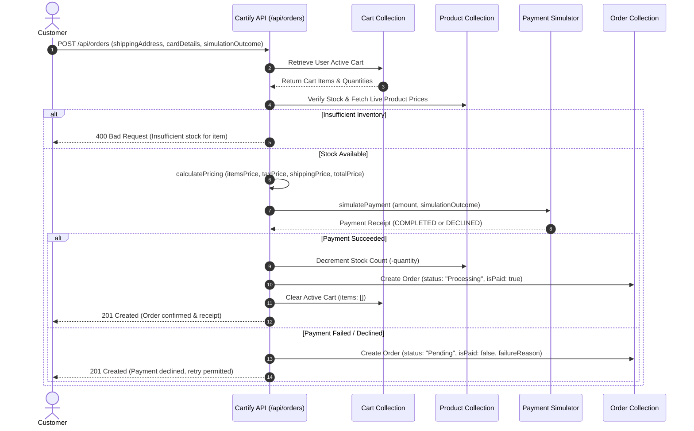

# 🛒 Cartify — Complete E-Commerce Backend RESTful API

[](https://nodejs.org/)
[](https://expressjs.com/)
[](https://www.mongodb.com/)
[](https://jwt.io/)
[](https://github.com/express-rate-limit/express-rate-limit)
[](https://opensource.org/licenses/ISC)

> **Cartify** is a production-grade, secure, and extensible RESTful backend engine for modern online storefronts. Built with **Node.js**, **Express.js**, and **MongoDB (Mongoose)**, it provides end-to-end e-commerce capabilities: customer authentication & RBAC, a searchable product catalog, persistent shopping carts, simulated payment gateways, inventory auto-deduction, and full test suites.

---

## 📑 Table of Contents

- [Project Overview](#-project-overview)
- [System Architecture](#-system-architecture)
- [Repository Structure](#-repository-structure)
- [Core Features & Technical Capabilities](#-core-features--technical-capabilities)
- [Tech Stack](#-tech-stack)
- [Installation & Quick Start](#-installation--quick-start)
- [Environment Configuration](#-environment-configuration)
- [Database Seeding & Test Credentials](#-database-seeding--test-credentials)
- [API Endpoints Overview](#-api-endpoints-overview)
- [API Usage Examples (cURL)](#-api-usage-examples-curl)
- [Payment Gateway Simulation Engine](#-payment-gateway-simulation-engine)
- [Security Hardening](#-security-hardening)
- [Testing Suite](#-testing-suite)
- [Quality Standards Checklist](#-quality-standards-checklist)
- [What I Learned](#-what-i-learned)
- [Deployment Guidelines](#-deployment-guidelines)
- [License](#-license)

---

## 🌟 Project Overview

**Cartify** was engineered to emulate the real-world operational workflow of enterprise e-commerce platforms like Amazon or Shopify. It solves key challenges in e-commerce backend engineering:

1. **State Isolation & Identity Management**: Secure customer registration, bcrypt-salted passwords, and stateless session verification via signed JSON Web Tokens (JWT).
2. **Dynamic Product Catalog**: High-throughput catalog search, compound text indexes, multi-criteria filtering (category, price range, stock availability), and sorting.
3. **Cart Persistence & Live Computation**: Persistent customer shopping carts with atomic operations, real-time price synchronization, and inventory guardrails.
4. **Order Processing & Inventory Integrity**: Safe checkout flow calculating subtotal, sales tax, and shipping tiers, coupled with atomic stock decrementing and transactional payment simulation.
5. **Defensive API Design**: Multi-layer security featuring strict rate limiting, Helmet HTTP headers, CORS policies, centralized error formatting, and Express-Validator sanitization.

---

## 🏛 System Architecture

The project follows the standard **Controller-Service-Repository / MVC** layered design pattern to maintain clean separation of concerns:

```
[ Client Request ] (Postman / Browser / Mobile App)
        │
        ▼
[ Security Middlewares ] (Helmet, CORS, Express-Rate-Limit, JSON Parser)
        │
        ▼
[ Router Layer ] (/api/auth, /api/products, /api/cart, /api/orders)
        │
        ▼
[ Authentication & Validation Middlewares ] (JWT protect, RBAC authorize, Express-Validator)
        │
        ▼
[ Controller Layer ] (Business Logic & Request/Response Orchestration)
        │
        ├──▶ [ Helper Utilities ] (simulatePayment, calculatePricing, sendResponse)
        │
        ▼
[ Mongoose Models & Database Layer ] (User, Product, Cart, Order) ──▶ [ MongoDB Cluster ]
        │
        ▼
[ Centralized Error Handler ] (Mongoose CastError, DuplicateKey 11000, 404, 500)
```

### Complete Checkout & Order Lifecycle Diagram



---

## 📂 Repository Structure

The project strictly follows the required directory layout:

```
Cartify/
├── src/
│   ├── config/
│   │   ├── database.js          # MongoDB connection & disconnect handlers
│   │   └── jwt.js               # JWT signing, token generation & verification
│   ├── controllers/
│   │   ├── authController.js    # Register, login, profile retrieval & updates
│   │   ├── productController.js # Catalog browsing, filters, search, admin CRUD
│   │   ├── cartController.js    # Add/remove items, quantity updates, clear cart
│   │   └── orderController.js   # Checkout, payment simulation, order history & status
│   ├── middleware/
│   │   ├── auth.js              # JWT verification & Role-Based Access Control (RBAC)
│   │   ├── errorHandler.js      # Global error formatting & 404 handler
│   │   └── validation.js        # Express-Validator request sanitization schemas
│   ├── models/
│   │   ├── User.js              # User schema, bcrypt pre-save hook, password compare
│   │   ├── Product.js           # Product schema, text search index, rating & stock
│   │   ├── Cart.js              # Cart items schema with computed virtual totals
│   │   └── Order.js             # Order schema, shipping address, payment receipt
│   ├── routes/
│   │   ├── authRoutes.js        # Mounted at /api/auth
│   │   ├── productRoutes.js     # Mounted at /api/products
│   │   ├── cartRoutes.js        # Mounted at /api/cart
│   │   └── orderRoutes.js       # Mounted at /api/orders
│   ├── utils/
│   │   ├── helpers.js           # Unified sendResponse, calculatePricing, simulatePayment
│   │   └── seed.js              # Database reset & catalog seeding script
│   ├── app.js                   # Express application setup, middlewares, routes
│   └── server.js                # Server entry point listening on PORT
├── tests/
│   ├── auth.test.js             # Authentication & user profile test cases
│   ├── products.test.js         # Product catalog, search, pagination, and admin CRUD tests
│   ├── cart-orders.test.js      # Full cart, checkout, payment simulation & stock decrement tests
│   └── setup.js                 # Global test database connection & teardown hooks
├── docs/
│   └── api-documentation.md     # Detailed API specification & endpoint schemas
├── .env.example                 # Template for required environment variables
├── .env                         # Active local configuration (git-ignored)
├── .gitignore                   # Excludes node_modules, .env, test databases, logs
├── package.json                 # Project dependencies, scripts, and engine metadata
└── README.md                    # Project documentation
```

---

## ⚡ Core Features & Technical Capabilities

### 1. User Authentication & Authorization (Week 2)
- **Password Security**: Passwords salted and hashed with `bcryptjs` (salt rounds: 10) inside Mongoose pre-save hooks. Passwords are automatically stripped via `toJSON` transform.
- **JWT Authentication**: High-security signed JSON Web Tokens containing user ID and role with configurable expiration (e.g. `7d`).
- **Role-Based Access Control (RBAC)**: Distinct authorization tiers for `user` and `admin`. Admin privileges are strictly enforced on catalog additions, modifications, deletions, and order status changes.
- **Profile Management**: Endpoints to inspect current profile and update user info (name, phone, multi-line shipping address) or change passwords securely with current password verification.

### 2. Product Catalog Management (Week 1 & 4)
- **Full-Text Search**: MongoDB `$text` and multi-field `$or` regex searching across product names, descriptions, categories, and brands.
- **Multi-Factor Filtering**: Real-time filtering by `category`, price range (`minPrice`, `maxPrice`), and availability (`inStock=true`).
- **Flexible Sorting**: Sorting options including `price_asc`, `price_desc`, `rating`, `name_asc`, and `newest` (default).
- **Pagination**: Zero-indexed, customizable pagination (`page`, `limit`) returning `currentPage`, `totalPages`, `totalProducts`, and `limit`.
- **Administrative CRUD**: Complete control for admins to create, update inventory/pricing, or delete products.

### 3. Shopping Cart Functionality (Week 3)
- **User-Bound Carts**: Direct association with user ID.
- **Live Inventory Guardrails**: Prevents adding quantities exceeding current stock in the database.
- **Dynamic Price Synchronization**: Updates cart items with live product pricing upon additions and modifications.
- **Virtual Computations**: Mongoose virtual getters compute `totalAmount` and `totalItems` on the fly without database redundancy.
- **Item Lifecycle**: Add items, update quantities, delete specific items, or clear entire carts.

### 4. Order Processing & Payment Gateway Simulation (Week 3)
- **Automated Pricing Engine**: Computes raw item totals, tiered shipping fees ($10 flat fee; free shipping threshold at $100+), and 8% standard sales tax.
- **Realistic Payment Simulation**: Simulates an external payment gateway (Stripe/PayPal) with realistic network latency, generating unique transaction references (`txn_<timestamp>_<hex>`).
- **Scenario Testing**: Supports testing card declines (`DECLINED`), insufficient funds (`INSUFFICIENT_FUNDS`), and successful payments (`SUCCESS`).
- **Inventory Auto-Deduction**: Decrements product stock automatically upon completed checkout; does not decrement on payment failure.
- **Automatic Cart Clearance**: Clears the customer's cart automatically upon successful payment.
- **Order Tracking**: Order lifecycle transitions through `Pending` ➔ `Processing` ➔ `Shipped` ➔ `Delivered` ➔ `Cancelled`.

### 5. Security & Reliability (Week 4)
- **Rate Limiting**: Protects against brute-force attacks (`20` attempts / 15 min for auth; `100` requests / 15 min for general API).
- **Helmet HTTP Headers**: Secures against Cross-Site Scripting (XSS), Clickjacking, and MIME-sniffing.
- **CORS Protection**: Configured cross-origin resource sharing.
- **Payload Limits**: Request bodies restricted to 50KB to mitigate memory exhaustion and DDoS vectors.
- **Input Validation**: `express-validator` chains validate and sanitize all inputs before reaching controllers.
- **Centralized Error Handling**: Handles Mongoose `CastError` (invalid ObjectIDs), `ValidationError`, Duplicate Key `11000`, and JWT expiration with clean, consistent JSON responses.

---

## 🛠 Tech Stack

| Technology | Purpose | Version |
| :--- | :--- | :--- |
| **Node.js** | Server Runtime Environment | `v22.x+` |
| **Express.js** | HTTP Framework & Routing | `v5.3+` |
| **MongoDB** | NoSQL Document Database | `v8.x+` |
| **Mongoose** | Object Data Modeling (ODM) | `v9.1+` |
| **JSON Web Tokens (JWT)** | Stateless Authentication | `v9.0+` |
| **bcryptjs** | Password Hashing Algorithm | `v3.0+` |
| **express-validator** | Input Validation & Sanitization | `v7.3+` |
| **express-rate-limit** | DDoS & Brute-Force Rate Limiting | `v8.7+` |
| **Helmet** | HTTP Security Headers | `v8.3+` |
| **Morgan** | HTTP Request Logger | `v1.12+` |
| **Cors** | Cross-Origin Resource Sharing | `v2.8+` |
| **Jest** | Automated Test Runner | `v30.5+` |
| **Supertest** | HTTP Integration Testing | `v7.3+` |

---

## 🚀 Installation & Quick Start

### Prerequisites
- **Node.js** (v18.0.0 or higher) installed
- **MongoDB** running locally on port `27017` or a **MongoDB Atlas** cloud URI
- **Git**

### 1. Clone & Install
```bash
# Clone the repository
git clone https://github.com/your-username/Cartify.git
cd Cartify

# Install dependencies
npm install
```

### 2. Configure Environment Variables
Copy `.env.example` to `.env`:
```bash
cp .env.example .env
```
Ensure your MongoDB connection string in `.env` is correct (defaults to `mongodb://127.0.0.1:27017/cartify`).

### 3. Seed the Database
Populate your database with sample categories, products, an admin account, and a test customer:
```bash
npm run seed
```

### 4. Run the Server
```bash
# Development mode with auto-reload (nodemon)
npm run dev

# Or production mode
npm start
```
The server will boot and display:
```
[Database] MongoDB Connected successfully: 127.0.0.1/cartify
[Server] Cartify API server listening on http://localhost:5000
[Server] Environment: development
```

### 5. Verify API Health
Open your browser or run:
```bash
curl http://localhost:5000/api/health
```

---

## ⚙️ Environment Configuration

| Variable | Default Value | Description |
| :--- | :--- | :--- |
| `PORT` | `5000` | Port on which the Express server listens |
| `NODE_ENV` | `development` | Runtime environment (`development` / `production` / `test`) |
| `MONGO_URI` | `mongodb://127.0.0.1:27017/cartify` | MongoDB connection URI |
| `JWT_SECRET` | *(Secure string)* | Secret key used to sign and verify JWT tokens |
| `JWT_EXPIRE` | `7d` | Token expiration duration (`7d`, `24h`) |
| `RATE_LIMIT_WINDOW_MS`| `900000` (15 min) | Time window for rate limiter |
| `RATE_LIMIT_MAX` | `100` | Max API requests per window per IP |
| `AUTH_RATE_LIMIT_MAX`| `20` | Max auth requests per window per IP |

---

## 👥 Database Seeding & Test Credentials

Running `npm run seed` creates pre-configured testing accounts and 10 realistic products across **Electronics, Fashion, Home & Kitchen, Gaming, and Wearables**:

### Pre-Configured Test Accounts

| Role | Email Address | Password | Permissions |
| :--- | :--- | :--- | :--- |
| **Administrator** | `admin@cartify.com` | `AdminPassword123!` | Full Access: Catalog CRUD, Order status management |
| **Customer** | `shopper@cartify.com` | `ShopperPassword123!` | Standard Access: Browse, Cart, Checkout, Profile |

---

## 📡 API Endpoints Overview

| Module | Method | Endpoint | Access | Description |
| :--- | :---: | :--- | :---: | :--- |
| **System** | `GET` | `/` | Public | API welcome & catalog link index |
| **System** | `GET` | `/api/health` | Public | System uptime & health status |
| **Auth** | `POST` | `/api/auth/register` | Public | Register new customer account |
| **Auth** | `POST` | `/api/auth/login` | Public | Authenticate user & issue JWT |
| **Auth** | `GET` | `/api/auth/profile` | Private | Retrieve logged-in user profile |
| **Auth** | `PUT` | `/api/auth/profile` | Private | Update user profile / change password |
| **Products** | `GET` | `/api/products` | Public | List products (Search, filter, paginate, sort) |
| **Products** | `GET` | `/api/products/categories` | Public | Get all distinct product categories |
| **Products** | `GET` | `/api/products/:id` | Public | Get single product by ID |
| **Products** | `POST` | `/api/products` | Admin | Create a new catalog product |
| **Products** | `PUT` | `/api/products/:id` | Admin | Update product details / inventory |
| **Products** | `DELETE` | `/api/products/:id` | Admin | Delete a product from catalog |
| **Cart** | `GET` | `/api/cart` | Private | Retrieve current user's shopping cart |
| **Cart** | `POST` | `/api/cart` | Private | Add item to cart (with stock validation) |
| **Cart** | `PUT` | `/api/cart/:itemId` | Private | Update item quantity in cart |
| **Cart** | `DELETE` | `/api/cart/:itemId` | Private | Remove specific item from cart |
| **Cart** | `DELETE` | `/api/cart` | Private | Empty all items from cart |
| **Orders** | `POST` | `/api/orders` | Private | Checkout cart with payment simulation |
| **Orders** | `GET` | `/api/orders` | Private | View user order history (paginated) |
| **Orders** | `GET` | `/api/orders/:id` | Private | Get single order details (Owner/Admin) |
| **Orders** | `PUT` | `/api/orders/:id/status` | Admin | Update status (`Processing`, `Shipped`, etc.) |
| **Orders** | `POST` | `/api/orders/:id/pay` | Private | Re-simulate payment on a pending order |

---

## 💻 API Usage Examples (cURL)

### 1. User Registration
```bash
curl -X POST http://localhost:5000/api/auth/register \
  -H "Content-Type: application/json" \
  -d '{
    "name": "Alex Mercer",
    "email": "alex@example.com",
    "password": "SecurePassword123!",
    "phone": "+1-555-0144",
    "address": {
      "street": "100 Pine St",
      "city": "Seattle",
      "state": "WA",
      "postalCode": "98101",
      "country": "USA"
    }
  }'
```

### 2. User Login
```bash
curl -X POST http://localhost:5000/api/auth/login \
  -H "Content-Type: application/json" \
  -d '{
    "email": "shopper@cartify.com",
    "password": "ShopperPassword123!"
  }'
```
*Save the returned `data.token` for authenticated calls.*

### 3. Browse Products with Search, Filters & Sorting
```bash
curl -X GET "http://localhost:5000/api/products?search=headphones&category=electronics&sort=price_asc&page=1&limit=5"
```

### 4. Add Product to Shopping Cart
```bash
curl -X POST http://localhost:5000/api/cart \
  -H "Content-Type: application/json" \
  -H "Authorization: Bearer <YOUR_JWT_TOKEN>" \
  -d '{
    "productId": "<PRODUCT_OBJECT_ID>",
    "quantity": 2
  }'
```

### 5. Checkout & Place Order (with Payment Simulation)
```bash
curl -X POST http://localhost:5000/api/orders \
  -H "Content-Type: application/json" \
  -H "Authorization: Bearer <YOUR_JWT_TOKEN>" \
  -d '{
    "shippingAddress": {
      "street": "742 Evergreen Terrace",
      "city": "Springfield",
      "state": "OR",
      "postalCode": "97477",
      "country": "USA"
    },
    "paymentMethod": "simulation",
    "simulationOutcome": "SUCCESS",
    "cardDetails": {
      "cardNumber": "4242 4242 4242 4242",
      "brand": "Visa"
    }
  }'
```

---

## 💳 Payment Gateway Simulation Engine

The backend includes a built-in payment simulator (`src/utils/helpers.js`) that mimics payment services like Stripe or PayPal:

- **Configurable Outcomes**:
  - `SUCCESS`: Transaction succeeds, generates transaction receipt, sets `isPaid: true`, marks status as `Processing`, decrements stock, and empties the cart.
  - `DECLINED`: Simulates bank card decline. Creates order with `Pending` status; stock is preserved.
  - `INSUFFICIENT_FUNDS`: Simulates insufficient account balance.
- **Card Triggers**: Card numbers ending in `0000 0000 0000 0000` or `4000 0000 0000 0002` trigger automated declines.
- **Latency Emulation**: Injects realistic network roundtrip latency (80ms).

---

## 🛡 Security Hardening

- **Stateless JWT with Expiration**: Prevents server-side session bloat while verifying client authenticity on every request.
- **Password Hashing with Salt Rounds**: Plaintext passwords never enter the database; salted with 10 rounds of bcrypt.
- **Strict Input Sanitization**: Parameters and body fields are checked using `express-validator` to eliminate script injection and type coercion.
- **DDoS & Brute-Force Rate Limiting**: Dedicated rate limiting on login/register endpoints prevents credential stuffing.
- **HTTP Header Security**: `helmet` enforces Content-Security-Policy, HSTS, Frameguard, and X-Content-Type-Options.
- **CORS Protection**: Prevents cross-origin unauthorized script invocation.
- **Safe MongoDB Queries**: Query sanitization and structured ObjectId validation prevents NoSQL injection attacks.

---

## 🧪 Testing Suite

Cartify comes with automated test suites built with **Jest** and **Supertest**:

```
tests/
├── auth.test.js        # Registration, duplicate handling, login, profile updates, password change
├── products.test.js    # Catalog filtering, search, sorting, pagination, admin CRUD & authorization
├── cart-orders.test.js # Cart operations, stock overflow prevention, checkout, payment simulation, stock deduction
└── setup.js            # Isolated test database runner & collection cleanup
```

### Running Tests
Make sure MongoDB is running, then execute:
```bash
npm test
```

### Test Coverage Highlights
- ✅ **Authentication**: Tests registration, duplicate email rejection (409), invalid credentials (401), profile retrieval, and password updates.
- ✅ **Catalog**: Tests pagination bounds, category filtering, search term matching, ascending/descending price sorting, and admin authorization enforcement (403 for non-admins).
- ✅ **Cart**: Tests adding items, exceeding available stock rejection (400), quantity updates, item deletion, and cart clearing.
- ✅ **Orders & Checkout**: Tests full checkout, simulated successful payment, stock decrementing, simulated card decline handling, and order status transitions.

---

## 📋 Quality Standards Checklist

All requirements from the project specification have been implemented and verified:

- [x] **Project Overview**: Clear description of project goals, features, and technical capabilities.
- [x] **Setup Instructions**: Step-by-step installation, environment configuration, and startup guide.
- [x] **Code Structure**: Clean, modular MVC file hierarchy separating models, controllers, routes, middlewares, configs, and utilities.
- [x] **Visual Documentation**: Sequence diagrams and architecture flowcharts illustrating checkout and request lifecycles.
- [x] **Technical Details**: In-depth explanations of algorithms (bcrypt, JWT, pricing calculation, pagination, payment simulation).
- [x] **Testing Evidence**: Automated test suites covering Auth, Products, Cart, and Orders with Supertest assertions.
- [x] **API Documentation**: Detailed endpoint catalog with request/response formats and cURL examples (both in README and `docs/api-documentation.md`).

---

## 💡 What I Learned

Building this production-ready e-commerce backend provided deep hands-on experience in:

1. **Node.js & Express Architecture**: Structuring a scalable backend application using modular routing, centralized error handling, and reusable middleware chains.
2. **REST API Design Best Practices**: Standardizing JSON response formats (`success`, `data`, `pagination`, `errors`), utilizing correct HTTP status codes (`200`, `201`, `400`, `401`, `403`, `404`, `409`), and building intuitive query parameter interfaces.
3. **Authentication & Access Control**: Implementing token-based authentication with JWT, securely storing passwords via bcrypt pre-save hooks, and building granular Role-Based Access Control (RBAC).
4. **Database Operations & Modeling with Mongoose**:
   - Designing relational links using Mongoose `ref` (`User` ➔ `Cart` ➔ `Product` ➔ `Order`).
   - Defining `$text` indexes for search.
   - Using Mongoose virtual getters for calculated values.
   - Managing inventory consistency during concurrent checkout operations.
5. **Defensive API Security**: Protecting endpoints against common web vulnerabilities with rate limiting, Helmet security headers, body size restrictions, and input validation.
6. **Payment Gateway Mechanics**: Understanding how real-world payment processors (Stripe, PayPal) handle transactions, idempotency, webhook receipts, and failure states.

---

## ☁️ Deployment Guidelines

### Deploying to Cloud Platforms (Render / Railway / Heroku)

1. **Set Up MongoDB Atlas**:
   - Create a free cluster on [MongoDB Atlas](https://www.mongodb.com/atlas).
   - Create a database user and whitelist network access (`0.0.0.0/0`).
   - Copy your connection string (e.g., `mongodb+srv://<user>:<password>@cluster0.mongodb.net/cartify?retryWrites=true&w=majority`).

2. **Configure Environment Variables**:
   In your cloud dashboard (Render/Railway), add:
   - `NODE_ENV`: `production`
   - `PORT`: `5000` (or leave default assigned by platform)
   - `MONGO_URI`: *Your MongoDB Atlas connection URI*
   - `JWT_SECRET`: *A secure 64-character random string*
   - `JWT_EXPIRE`: `7d`

3. **Deploy from Git**:
   - Link your GitHub repository.
   - Build Command: `npm install`
   - Start Command: `npm start`
   - Run seed script once in console: `npm run seed`

---

## 📄 License

This project is licensed under the [ISC License](LICENSE).
Feel free to use and extend this codebase for learning or commercial e-commerce applications.
